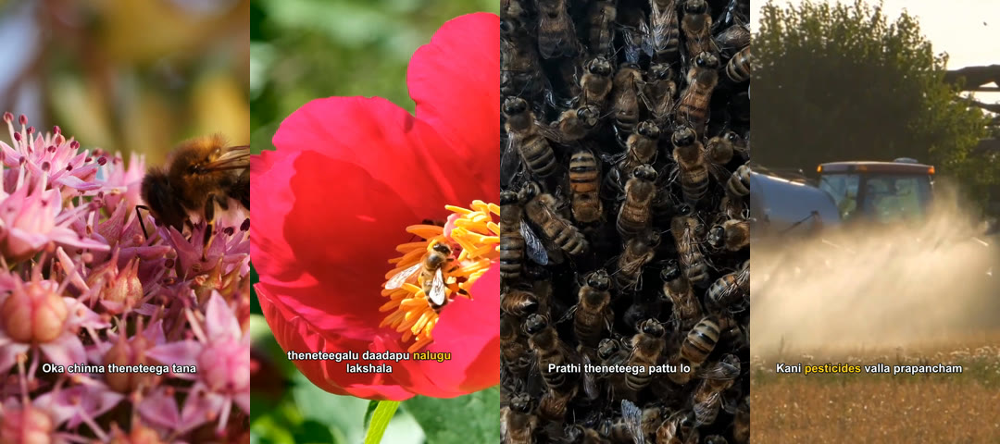
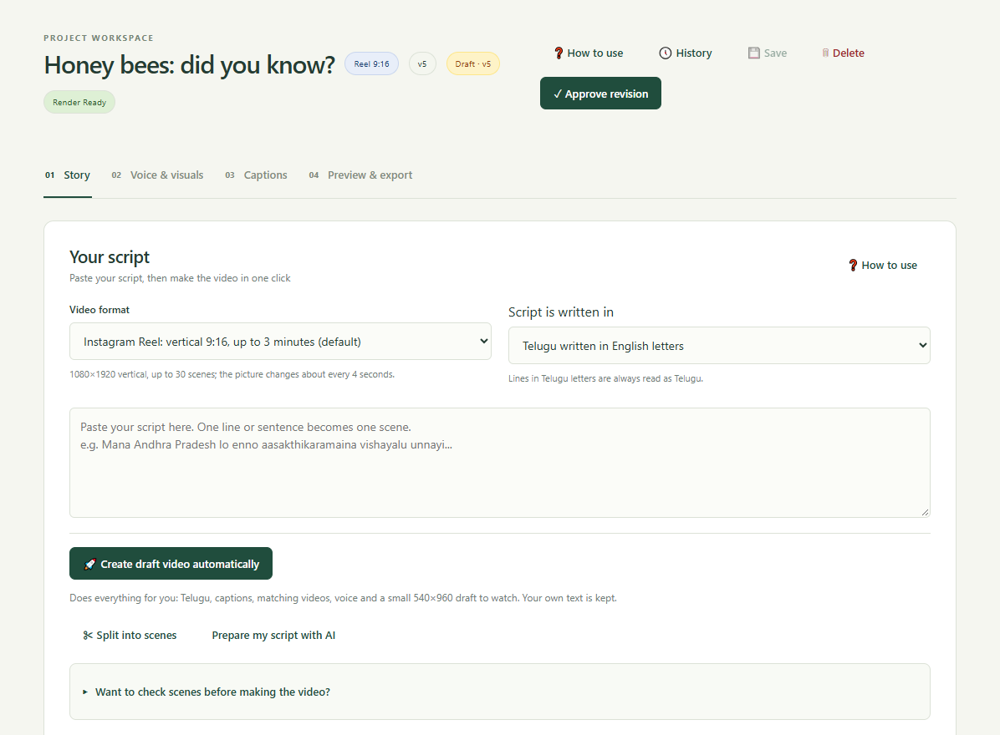
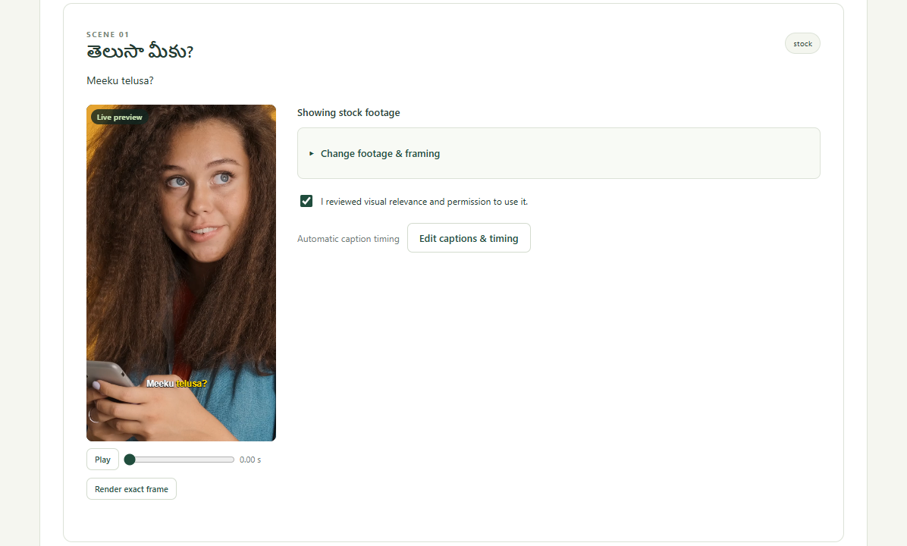
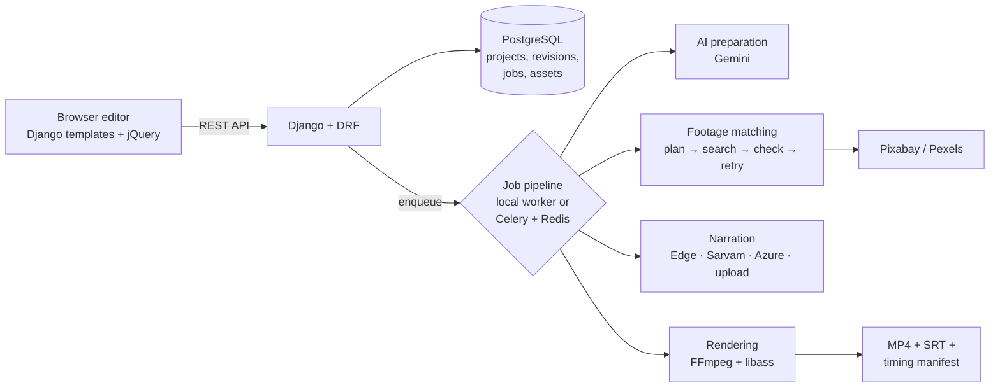

# Telugu Reel Studio

[](https://github.com/Sandeepjanjirala/Video-Automation/actions/workflows/tests.yml)


[](LICENSE)

Turns a Telugu script into a finished video with one click: a vertical Instagram Reel (1080×1920)
or a landscape YouTube video (1920×1080) with matching stock footage, Telugu narration and
burned-in captions.



*Four frames of a 49-second reel made from a nine-line script: each line gets footage of what it
talks about, and the caption's key words are highlighted.*

## What it does

Paste a script written in Telugu or in Telugu written in English letters, then click
**Create draft video automatically**:

1. **Prepares every scene with AI** (Gemini): Telugu narration, captions, stock search phrases and
   the words to highlight, keeping anything you wrote yourself.
2. **Finds footage that matches the words.** It plans one shot per part of each line, searches
   Pixabay (and Pexels), lets Gemini score preview frames of the candidates, and searches again for
   weak shots. In a reel, each landscape clip is framed on its subject.
3. **Records the narration** with a free Telugu voice (Edge), Sarvam or Azure, or uses your own
   recording, cleaned of rumble and background noise.
4. **Renders a draft** to review, then the full-resolution MP4 with timed captions, music ducking and
   an automatic quality check.

Measured on a 16-core PC with real Gemini and Pixabay: a 9-scene reel goes from pasted script to
draft in about a minute, and the 1080×1920 final takes about 18 seconds more.

| Editor | A scene with its matched clip and live caption preview |
|---|---|
|  |  |

## Architecture



- **Django + Django REST Framework** serve the API and the editor; the editor is server-rendered
  templates with modular jQuery.
- **PostgreSQL** stores projects as immutable, approved revisions, plus jobs, media assets and voice
  takes. Separate database roles limit what each part may write.
- **Jobs** (AI preparation, footage, narration, render) run in one leased pipeline, either in a single
  local worker process or on Celery workers fed by a transactional-outbox dispatcher over Redis.
- **FFmpeg** does all media work: framing, captions (libass, with Telugu text shaping), the soundtrack
  and the final checks.

## Engineering highlights

- **Reliable background jobs.** Each job holds a lease renewed by a heartbeat and checked before every
  write (fencing), so a crashed or duplicate worker can never overwrite a newer result. Cancelling a
  job stops its FFmpeg processes within a second.
- **Edits are never lost.** Revisions are immutable and saved with optimistic locking; autosave keeps
  unsaved work; a job's result is merged field by field, so edits made while it ran survive.
- **Footage matched to the words.** Gemini plans what the viewer should see for each part of a line,
  then judges preview frames of the candidates. Shots that score low are planned again from what was
  rejected. Plans are checked against the script so a shot can't drift onto another scene's words.
- **Frame-accurate rendering.** A shared 30 fps timeline drives scenes, captions and sound. Each
  scene is cached and rendered in a single FFmpeg filter graph. The browser's framing preview uses the
  same geometry as the renderer, pixel for pixel.
- **Broadcast-style audio.** The soundtrack is built once and sample-exact: narration levelled to
  -16 LUFS (EBU R128), music ducked under the voice, peaks limited, then encoded once. Uploaded
  recordings are cleaned with the noise reducer's 25 ms delay compensated, so captions stay in sync.
- **Every export is verified**: codec, frame rate, audio and video length, fast start, a full
  decode, and checks for black picture, silence and loudness.
- **Fast where it matters.** Searches run in parallel within the providers' rate limits, clips
  download while weak shots are searched again, and narration is recorded during the footage search.

## Tech stack

| | |
|---|---|
| Backend | Python 3.12, Django 5.1, Django REST Framework, Pydantic 2 |
| Data | PostgreSQL 18, Redis 7 |
| Jobs | Celery 5 with a transactional-outbox dispatcher, or one local worker |
| Media | FFmpeg 7.1+ (libx264, libass), EBU R128 loudness, FFT noise reduction |
| AI and APIs | Google Gemini (multimodal), Pixabay, Pexels, Edge TTS, Sarvam, Azure Speech |
| Frontend | Django templates, jQuery, HTML5 media |
| Deployment | Docker Compose, Caddy (automatic HTTPS) |
| Testing | pytest against an isolated PostgreSQL database with real FFmpeg renders; jsdom for the editor |

## Quick start

### Docker (server or any OS)

```bash
git clone https://github.com/Sandeepjanjirala/Video-Automation.git
cd Video-Automation
cp .env.example .env        # add STUDIO_GEMINI_KEY (and any other keys you use)
docker compose up -d --build
```

Open http://127.0.0.1:8788. For a public server with HTTPS on your domain:

```bash
STUDIO_DOMAIN=studio.example.com docker compose -f docker-compose.yml -f docker-compose.https.yml up -d --build
```

### Windows

Requires Python 3.12, FFmpeg 7.1+ and a running PostgreSQL (`docker compose up -d postgres redis`
starts one).

```powershell
SETUP_WINDOWS.bat                               # creates .venv and installs dependencies
.venv\Scripts\python.exe manage.py migrate
START_WINDOWS.bat                               # http://127.0.0.1:8788
```

`START_PHONE_ACCESS.bat` also serves phones and tablets on the same Wi-Fi. The
[user guide](docs/USER_GUIDE.md#start-on-windows) has the details.

## Configuration

Keys go in `.env` (git-ignored); see [.env.example](.env.example).

| Variable | Purpose |
|---|---|
| `STUDIO_GEMINI_KEY` | Scene preparation and footage matching (required for AI features) |
| `STUDIO_PIXABAY_KEY`, `STUDIO_PEXELS_KEY` | Stock footage |
| `STUDIO_SARVAM_KEY`, `STUDIO_AZURE_KEY` | Paid Telugu voices (the Edge voice needs no key) |
| `STUDIO_PASSWORD` | Sign-in password for other devices and Docker |
| `STUDIO_DATABASE_URL` | PostgreSQL connection |

## Tests

```powershell
.venv\Scripts\python.exe -m pip install -r requirements-dev.txt
npm ci --prefix frontend
.venv\Scripts\python.exe scripts/run_audit_tests.py
```

The suite creates and drops its own PostgreSQL database and never uses real API keys. It renders real
videos with FFmpeg, measures audio timing and loudness, and runs the editor's JavaScript in jsdom.
CI runs the same suite in Docker on every push.

## Project structure

```
config/          Django settings, URLs and database roles
core/            API views, models, middleware and the services that change projects
studio/          the production pipeline
  footage.py       shot planning, search, AI checking and download
  tasks.py         leased job pipeline and the scene renderer
  framing.py       crop and placement geometry (mirrored in static/js/framing.js)
  soundtrack.py    narration, clip sound and music mixed into one track
  narration.py     recording analysis, scene placement and clean-up
  timeline.py      frame-accurate timing shared by renderer, captions and export
  voice/           Edge, Sarvam, Azure and upload voice adapters, Voice Lab
  static/, ../templates/   the editor
tests/           audit suite (pytest) and editor tests (jsdom)
docs/            user guide and images
```

## Documentation

The [user guide](docs/USER_GUIDE.md) covers every feature in detail: video formats, the footage
search, your own narration, the caption editor, caption styles, framing, sound and the export check,
phone access and server deployment.

## License

[MIT](LICENSE) © 2026 Janjirala Sandeep. Stock footage comes from [Pixabay](https://pixabay.com/service/license-summary/)
and [Pexels](https://www.pexels.com/license/) under their licenses; see [THIRD_PARTY_NOTICES.txt](THIRD_PARTY_NOTICES.txt)
for bundled software.
