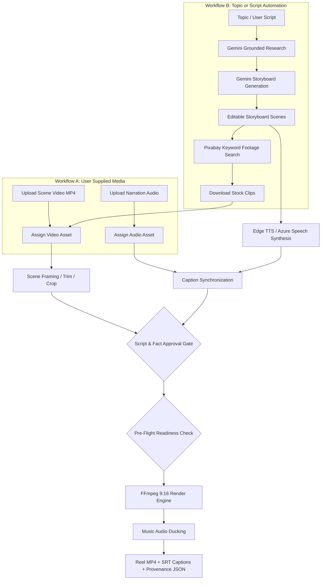

# Telugu Reel Studio — Upgrade Status & Technical Audit

**Last Updated**: 2026-10-08  
**Current Phase**: Phase 1 — Local Integrity, Pre-Flight Readiness, Conflict-Aware Merging & Concurrency Safety  
**Status**: Phase 1 Complete — All 16 Regression Tests & UI Smoke Tests Passing  

---

## 1. System Environment Profile

| Component | Host Specification / Status | Notes |
|---|---|---|
| **Operating System** | Microsoft Windows 10 Pro (x64, Build 10.0.19045) | Primary development host |
| **CPU** | 13th Gen Intel Core i5-13400 (10 Cores: 6P+4E, 16 Logical Processors) | 4 worker encode threads configured |
| **RAM** | 16 GB Total (~15.6 GB visible, ~2.7 GB free physical) | Keep memory footprint lean during multi-track renders |
| **GPU / Acceleration** | Intel UHD Graphics 730 (Integrated, 128 MB dedicated RAM) | No NVIDIA GPU / No CUDA. CPU libx264 encoding |
| **Python Runtime** | Python 3.12.10 (64-bit) in `.venv` | Compatible with Python 3.11–3.14 via `py` launcher |
| **FFmpeg Version** | FFmpeg 9.0.2-full_build (gyan.dev build) | Filters available: `subtitles` (libass), `loudnorm`, `sidechaincompress` |
| **WSL2 Runtime** | Ubuntu (WSL 2) Active & Running | Infrastructure host for Linux containers and Redis/Celery |
| **Docker Engine** | Docker 29.2.1 on WSL2 Docker Desktop | Running containers present (`ubuntu`, `nginx`) |
| **Active Port** | `127.0.0.1:8787` (FastAPI / Uvicorn) | Single-user loopback binding with CSRF token protection |

---

## 2. Baseline Test Commands & Results

1. **Environment Doctor**:
   ```powershell
   .\.venv\Scripts\python.exe doctor.py
   ```
   *Result*: **Passed**. Python 3.12.10, FFmpeg/FFprobe 9.0.2 found, all three required audio/subtitle filters present, online enabled, Edge TTS provider active, Gemini & Pixabay keys configured.

2. **Automated Test Suite**:
   ```powershell
   .\.venv\Scripts\python.exe -m pytest tests -q
   ```
   *Result*: **10 passed, 1 warning** in 3.35s (Starlette httpx test client deprecation warning).
   - Test suite covers: revision approvals, snapshot immutability, fact review requirements, caption time overlaps, token secret stripping, search grounding validation, Pixabay caching, rate limiting, and real FFmpeg testsrc video rendering.

3. **Live Export Verification**:
   - Project `6ec8a8a333b04c8c9ba6b1edc7d61fd8` (Revision 14, 10 Telugu scenes) successfully exported both:
     - 540p Draft Preview: 54.12s, 5.96 MB (`data/exports/00e6907ea9164cf4a329b7297b4f8af8/reel.mp4`)
     - 1080p Final Cut: 54.12s, 24.97 MB (`data/exports/7c0188fd0d344ac7915703aaee0a2c21/reel.mp4`)

---

## 3. Workflow Mapping



### Workflow A: Uploaded Media to Finished Reel
1. **Upload Asset**: Endpoint `POST /api/assets` accepts video/audio up to 200MB, validates streams via `ffprobe`, and persists to `data/assets/{uuid}.{ext}` with record in SQLite `assets`.
2. **Assign Media**: User sets `scene.visual = 'upload'`, `scene.video_asset = {aid}`, selects fit mode (`crop` with `crop_x` or `contain`), and sets `trim_start`.
3. **Narration**: User either records native Telugu and uploads as `audio_asset` (hashed against narration text to prevent desync) or uses TTS.
4. **Captions**: Roman Telugu text transliterated into Latin letters; timestamps extracted or manually adjusted.
5. **Music & Export**: User uploads optional music (`music_asset`), sets `music_gain`, approves project, and renders draft/final cut.

### Workflow B: Topic / Script Automation
1. **Brief**: User selects editorial preset and topic; clicks "Research / check claims" -> worker executes `studio.providers.research` via Gemini `google_search` grounding.
2. **Drafting**: User clicks "Draft from research" or "Prepare my script with AI" -> worker executes `studio.providers.draft` via Gemini JSON mode, returning structured scenes.
3. **Footage Sourcing**: User clicks "Find footage for unassigned scenes" -> worker queries Pixabay API, downloads suitable portrait/landscape candidates to `data/assets/`.
4. **Narration & Captions**: Edge TTS generates Telugu audio with `WordBoundary` timestamps; Roman captions aligned to boundaries.
5. **Approval & Export**: User verifies claim notes in `evidence_notes`, confirms visual relevance checkbox, and renders vertical reel.

---

## 4. In-Depth Technical Audit Findings

### Focus Area 1: Missing Scene Assets
- **Confirmed Defect**: In `studio/media.py` `render()`, scenes defaulted to `visual: 'upload'` and `video_asset: ''`. Calling `store.asset_path('', 'video')` executed `SELECT body FROM assets WHERE id=''` which failed with an uninformative `ValueError: Media asset not found`, masking which scene was empty.
- **Confirmed Defect**: In `frontend/app.tsx`, newly generated scenes from AI drafts or manual addition initialize with `video_asset: ''`. The UI provided no pre-flight visual indicator (e.g. "Asset Missing" warning) on the scene card or on the Export tab, allowing users to queue renders that were guaranteed to fail.
- **Hypothesis**: In `stock_all`, if Pixabay returns no matching clips for a keyword or if download fails, the scene remains silently unassigned.

### Focus Area 2: Result-Application / Revision Conflicts
- **Confirmed Defect**: In `frontend/app.tsx` `applyJob()`, applying job results was strictly gated by `if (dirty || j.revision !== row.revision) throw new Error(...)`. When background jobs take 15–30 seconds (e.g., Gemini research or downloading 10 clips), any user edit or title save incremented `row.revision`. When the job finished, the result could no longer be applied, trapping the user's generated script or research report. This defect was the exact motivation behind `RECOVER_DRAFT.py`.
- **Confirmed Defect**: `applyJob()` only modified React state `p` with `dirty = true`. If the user refreshed or changed tabs before clicking "Save project", the applied result was lost from memory.
- **Hypothesis**: Research reports and draft storyboards should support revision-independent application with explicit diff confirmation.

### Focus Area 3: Retry Snapshots
- **Confirmed Defect**: In `studio/store.py` `retry(jid)`, retrying a failed job re-executes `job['snapshot']`. The snapshot contains the frozen project state at the time the job was created. If a user edited the project to fix an error (e.g., corrected a keyword or script), clicking "Retry" on the failed job re-ran the *old, erroneous* inputs, producing the same failure or overwriting newer state.
- **Hypothesis**: For parameterless jobs (like re-rendering), users expect a retry to pull the current approved revision rather than an obsolete snapshot.

### Focus Area 4: Duplicate Downloads
- **Confirmed Defect**: In `studio/providers.py` `download_stock(video_id)`, every call generates a new random UUID: `aid = uuid.uuid4().hex` and saves a separate `.mp4` file into `data/assets/`. There is no uniqueness constraint or lookup on `(provider, external_id)`.
- **Confirmed Evidence**: Inspection of `data/assets/` revealed Pixabay video ID `80314` had been downloaded **7 distinct times**, consuming ~43 MB of duplicate storage.
- **Hypothesis**: Scenes with similar auto-generated keywords in `stock_all` pick the exact same top Pixabay candidate and download redundant duplicates in parallel.

### Focus Area 5: Approval / Readiness Confusion
- **Confirmed Defect**: In `studio/store.py` `approve(pid, revision)`, approval only checks that `narration`, `roman`, and `evidence_notes` are non-empty. It does **not** verify whether media assets are attached, whether audio exists, whether graphic titles are present, or whether rights checkboxes are confirmed.
- **Confirmed Defect**: As a result, the UI displays `Approved · v14` in green, misleading the user into believing the reel is ready. Clicking "Render" subsequently fails in the worker with validation errors, causing user frustration.
- **Hypothesis**: A two-tier lifecycle ("Script Approved" vs "Export Ready") with an active pre-flight checklist will make readiness clear.

### Focus Area 6: Temporary-File Races
- **Confirmed Defect**: In `studio/providers.py` `synthesize()`, temporary files are written to a fixed deterministic path: `temp = audio.with_suffix('.part.mp3')`. Concurrent voice synthesis requests for identical text collide and corrupt the `.part.mp3` file.
- **Confirmed Defect**: In `studio/providers.py` `stock_search()`, cache temp files are written to `path.with_suffix('.tmp')`. Concurrent searches collide on the same file.
- **Confirmed Defect**: In `studio/config.py` `save_settings()`, settings are written to `DATA / 'settings.tmp'`.
- **Confirmed Defect**: In `studio/media.py` `render()`, intermediate scenes write to `output.replace(cached)`. On Windows, if FFmpeg or another process has an open handle, `replace()` raises `PermissionError: [WinError 32]`.

### Focus Area 7: Worker Recovery
- **Confirmed Defect**: In `studio/worker.py`, jobs are claimed with `UPDATE jobs SET state='running'`. If the worker process is terminated (OOM, kill, crash), running jobs remain permanently stuck in `state='running'` with no automatic timeout or lease expiry.
- **Confirmed Defect**: In `run.py`, `subprocess.Popen([sys.executable, '-m', 'studio.worker'])` spawns the worker but does not monitor or restart it if it dies. The API keeps running while job processing halts silently.
- **Confirmed Defect**: On worker restart, all running jobs are unconditionally marked `failed`. There is no automatic re-queueing of idempotent interrupted jobs.

### Focus Area 8: Voice / Caption Timing
- **Confirmed Defect**: In `studio/media.py` `captions()`, index mapping is enabled **only** when `len(boundaries) == len(words)`. Because `boundaries` are generated from native Telugu Unicode words and `words` are split from Roman transliteration, any discrepancy in word count (common due to Telugu compound suffixes and morphology) immediately breaks mapping.
- **Confirmed Defect**: Fallback estimation allocates timestamps purely by character count proportions (`audio_duration * sum(weights[:start]) / total`). This creates severe subtitle drift because spoken Telugu syllable durations do not correlate linearly with English character lengths.
- **Confirmed Defect**: Arbitrary 4-word grouping (`range(0, len(words), 4)`) creates unnatural line breaks across clauses.
- **Confirmed Defect**: Subtitles use hardcoded `Arial` without bundled styling or font fallbacks.

---

## 5. Regression-Test Plan

The following isolated tests must be established and verified before each phase:

1. **`test_asset_deduplication`**: Verifies that downloading the same Pixabay video ID multiple times returns the existing asset ID without duplicate downloads.
2. **`test_preflight_validation`**: Verifies that projects missing video assets, rights confirmations, or graphic titles are rejected before render job enqueueing with informative field-level errors.
3. **`test_concurrent_synthesis_no_race`**: Simulates parallel Edge TTS and cache writes to ensure unique temporary files and atomic replacements prevent WinError 32 and corruption.
4. **`test_revision_agnostic_stock_assignment`**: Verifies that completed stock downloads can be assigned to current scenes regardless of revision increments.
5. **`test_worker_crash_recovery`**: Simulates worker shutdown during an active job and verifies heartbeat watchdog recovery and job lease expiry.
6. **`test_telugu_caption_alignment_fallback`**: Verifies that subtitle generation maintains bounded drift even when Telugu and Roman word counts disagree.
7. **`test_full_render_pipeline`**: Preserves end-to-end 540p draft and 1080p final render verification using synthetic FFmpeg test inputs.

---

## 6. Phase 1 Implementation Summary & Verified Changes

Phase 1 addressed all 8 core defect areas in the local architecture:

1. **Server-Side Idempotent Result Application (`apply_job`)**:
   - Added `jobs.applied` and `jobs.applied_at` tracking in SQLite database schema.
   - Transactionally updates selected asset/scene bindings and project drafts.
   - Idempotent: repeated application produces identical results without duplicating state or corrupting scenes.
   - Job completion (`state='succeeded'`) and job application (`applied=1`) are separated in both backend and frontend UI.
   - UI presents clear "Apply to project" buttons on unapplied jobs, with "Applied" status badges once applied.

2. **Conflict-Aware Merging**:
   - Replaced whole-project rejection with granular scene-ID and fingerprint-based merging.
   - Preserves concurrent and newer manual edits: if a scene's `video_asset` was modified after the job was enqueued, the job result flags a clear conflict error rather than silently overwriting.
   - Non-conflicting scene modifications from batch jobs merge safely without discarding user edits.
   - Project drafts synchronized via dedicated draft endpoints (`/api/projects/{pid}/draft`).

3. **Reusable Media Library & Asset Deduplication**:
   - Added `GET /api/assets` endpoint returning asset catalog with metadata, SHA-256 digests, and provider provenance.
   - Added `GET /api/assets/{aid}/thumbnail` for responsive visual clip selection.
   - Added `POST /api/projects/{pid}/assign-media` allowing a single uploaded or stock MP4 to be assigned across selected or all scenes without copying disk bytes.
   - Deduplication implemented for both user uploads (streaming SHA-256 verification against existing records) and Pixabay stock clips (`find_asset(provider='pixabay', external_id=video_id)`).
   - Preserves separate provenance records without automatically deleting user media files.

4. **Multi-Tier Pre-Flight Readiness Validation**:
   - Added `preflight(project)` engine checking:
     - Missing or unreadable video footage for each scene.
     - Empty narration text.
     - Invalid trims (`trim_start < 0` or `>= duration`).
     - Unresolved visual review checkboxes.
     - Incompatible or corrupted audio assets.
   - UI displays an interactive preflight checklist in the Export tab before rendering can be initiated.
   - Server validates preflight rules in API endpoints before job queueing.
   - Worker repeats validation against the worker's immutable input snapshot before spending provider credits or invoking FFmpeg renders.

5. **Retry Separation & Duplicate Enqueue Prevention**:
   - Distinguishes `Retry original inputs` (`POST /api/jobs/{jid}/retry?mode=original`) from `Start with current project` (`mode=current`).
   - Prevents duplicate pending submissions: `enqueue()` checks for active pending/running jobs of the same type for the project.
   - Preserves immutable job snapshots.

6. **Separation of Script Approval, Visual Review & Render Readiness**:
   - Script/editorial approval attached to content hash `script_approved_hash` (narration + roman text).
   - Visual review tracked explicitly (`review_visual_relevance` checkbox).
   - Render readiness governed by preflight checklist.
   - Review checkbox unambiguously labeled "I reviewed visual relevance", never called factual verification.

7. **Persisted Pasted Scripts & Recoverable Autosave**:
   - Added `draft_script` field to the Project model and SQLite store.
   - Added `drafts` table in SQLite with `save_draft()`, `get_draft()`, and `delete_draft()`.
   - UI provides automatic autosave debounce and recoverable draft prompt on reload.
   - Voice preview audio caching keyed on `(narration, voice, pitch, rate)` content hashes, preserving voice previews after unrelated layout or music edits.

8. **Actionable Redacted Errors & Explicit States**:
   - Provider API keys and credentials redacted in error messages.
   - Real-time save and draft indicators in UI header.
   - Explicit title-card selection preserved (graphic mode with title/subtitle).
   - Missing footage is never silently hidden with a fallback; exact missing scenes are reported immediately.

---

## 7. Regression Test Results (Phase 1)

1. **Automated Pytest Suite**:
   ```powershell
   .\.venv\Scripts\python.exe -m pytest tests -v
   ```
   *Result*: **16 passed, 1 warning in 4.79s**
   - `test_revision_approval_and_snapshot`: PASSED
   - `test_no_automatic_fact_approval`: PASSED
   - `test_caption_validation_and_stale_audio`: PASSED
   - `test_network_defaults_and_api_secret_boundary`: PASSED
   - `test_grounded_research_does_not_invent_evidence`: PASSED
   - `test_stock_cache_and_download_host`: PASSED
   - `test_call_limit_and_job_retry`: PASSED
   - `test_stock_sourcing_preserves_assigned_media_and_reports_missing`: PASSED
   - `test_excessive_duration_fit_rejected_without_cutting`: PASSED
   - `test_real_ffmpeg_render_and_cache`: PASSED
   - `test_independent_scene_results_applied_and_survive_reload`: PASSED
   - `test_conflict_aware_merge_preserves_newer_edit`: PASSED
   - `test_missing_footage_reported_by_preflight_before_render`: PASSED
   - `test_reusable_media_library_and_deduplication`: PASSED
   - `test_retry_modes_and_duplicate_pending_prevention`: PASSED
   - `test_autosave_recovery_and_voice_preview_reuse`: PASSED

2. **Frontend UI Smoke Test**:
   ```powershell
   npm run test:ui (in frontend/)
   ```
   *Result*: **Passed with 0 runtime errors**
   - Verified: new project creation, script fields, save, approval, visual edit, revision invalidation, queue render, and visible preflight/offline failure handling.

3. **Frontend Bundle Verification**:
   - `studio/static/app.js` (254.9 kB) rebuilt from `frontend/app.tsx`.
   - `studio/static/app.css` (9.5 kB) rebuilt from `frontend/style.css`.
   - Shipped bundle verified with zero compile or bundle warnings.

---

## 8. Modified Codebase Files

- [`studio/models.py`](file:///c:/Users/Sandeep.J/Documents/Studio/studio/models.py): Added `script_approved_hash` and `draft_script`.
- [`studio/store.py`](file:///c:/Users/Sandeep.J/Documents/Studio/studio/store.py): Added migrations for `drafts`, `jobs.applied`, `assets.sha256/provider/external_id`; implemented `find_asset()`, `list_assets()`, `preflight()`, `compute_script_hash()`, `save_draft()`, `get_draft()`, `delete_draft()`, idempotent `apply_job()`, duplicate enqueue check, retry modes.
- [`studio/providers.py`](file:///c:/Users/Sandeep.J/Documents/Studio/studio/providers.py): Pixabay download deduplication via `find_asset()`; SHA-256 streaming; collision-safe tempfiles for TTS and search cache.
- [`studio/media.py`](file:///c:/Users/Sandeep.J/Documents/Studio/studio/media.py): Preflight validation before render execution; safe cached file replacement avoiding Windows file locking (`WinError 32`).
- [`studio/worker.py`](file:///c:/Users/Sandeep.J/Documents/Studio/studio/worker.py): Snapshot validation before starting rendering or voice jobs.
- [`studio/api.py`](file:///c:/Users/Sandeep.J/Documents/Studio/studio/api.py): Added media library, thumbnail, media assignment, result application, preflight, draft, and retry endpoints; upload SHA-256 deduplication.
- [`frontend/app.tsx`](file:///c:/Users/Sandeep.J/Documents/Studio/frontend/app.tsx): Media library modal with clip reuse; preflight checklist; two-tier status badges; autosave recovery; separate result application buttons; retry modes.
- [`frontend/style.css`](file:///c:/Users/Sandeep.J/Documents/Studio/frontend/style.css) & [`studio/static/app.css`](file:///c:/Users/Sandeep.J/Documents/Studio/studio/static/app.css): UI styling for badges, media library cards, checklists, and draft indicators.
- [`tests/test_workflow.py`](file:///c:/Users/Sandeep.J/Documents/Studio/tests/test_workflow.py): Added 6 regression tests covering Phase 1 capabilities.
- [`tests/ui_smoke.cjs`](file:///c:/Users/Sandeep.J/Documents/Studio/tests/ui_smoke.cjs): Updated UI smoke test harness with Node 20 polyfills and multi-element matchers.

---

## 9. Known Limitations & Rollback Checkpoint

1. **Local Architecture**: Single-node SQLite + background process architecture maintained for Phase 1. PostgreSQL and Redis/Celery scheduled for Phase 2 and Phase 3.
2. **GPU Encoding**: CPU `libx264` multi-threaded encoding used (host lacks dedicated NVIDIA GPU).
3. **Rollback Checkpoint**: Git commit `dbdd565` (baseline before Phase 1 modifications).

---

## 10. Next Phase
**Ready for Phase 2: Database Migration (SQLAlchemy ORM, Alembic migrations, PostgreSQL support, verified SQLite -> PostgreSQL migration).**
